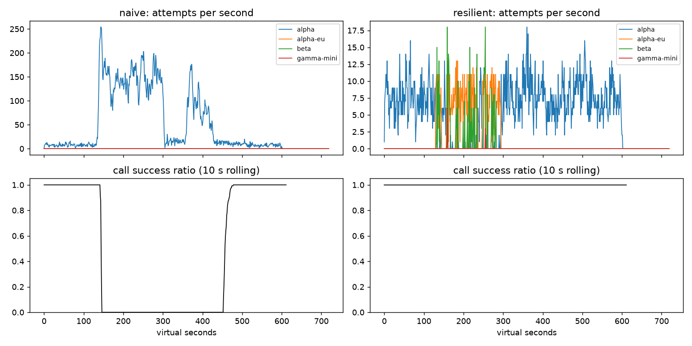

# Lab 25B — Report

**Họ tên / nhóm:** Nguyen Minh Hieu — MSV 2A202602669  **Commit:** 6cf3258  **Điểm tự động (`make grade`):** 84 / 88

> Số trong báo cáo lấy từ `reports/gameday/*.json`, `reports/cache/*.json`, `reports/workflows.json`,
> `reports/slo.json` (seed 25, cấu hình trong `configs/gameday.yaml`). 4 điểm còn thiếu là dữ liệu SLO ẩn do giảng
> viên chấm. Các thí nghiệm ở mục 3 và mục 8 chạy bằng cấu hình tạm, không commit.

## 1. Kết quả Game Day (naive vs của tôi)

| Băng | Client | availability | p95 (s) | amplification | retry_ratio | cost/turn | recovery (s) | PASS? |
|---|---|---:|---:|---:|---:|---:|---:|:---:|
| G1 | naive | 0,7194 | 7,157 | 7,738 | 6,738 | 2,163 | 4 | FAIL |
| G1 | yours | 1,0 | 4,817 | 1,060 | 0,001 | 2,094 | 0 | PASS |
| G2 | naive | 0,4560 | 15,034 | 9,904 | 8,904 | 4,627 | 155 | FAIL |
| G2 | yours | 1,0 | 10,781 | 1,038 | 0,005 | 2,116 | 0 | PASS |
| G3 | naive | 1,0 | 4,768 | 1,164 | 0,164 | 2,328 | 0 | FAIL |
| G3 | yours | 1,0 | 4,718 | 1,065 | 0,035 | 2,146 | 0 | PASS |
| G4 | naive | 1,0 | 13,764 | 1,004 | 0,004 | 2,008 | 0 | FAIL |
| G4 | yours | 1,0 | 5,684 | 1,013 | 0,002 | 2,069 | 0 | PASS |
| G5 | naive | 0,3699 | 5,359 | 17,030 | 16,030 | 2,124 | – | FAIL |
| G5 | yours | 0,8179 | 5,482 | 1,003 | 0,002 | 2,504 | – | PASS |
| G6 | naive | 0,5170 | 4,836 | 12,344 | 11,344 | 2,009 | 0 | FAIL |
| G6 | yours | 1,0 | 6,225 | 1,067 | 0,027 | 2,164 | 0 | PASS |

Các check riêng của từng băng (naive → của tôi):

- G1 `retry_after_violations`: 36.027 → 0.
- G2 `primary_share_after_restore`: 1,0 → 1,0 (naive chỉ biết `alpha`; của tôi quay lại `alpha` nhờ HALF-OPEN).
- G3: naive vẫn 100% availability nhưng trượt vì `retry_ratio` 0,164 > 0,10.
- G4: naive không có lỗi nào nhưng trượt vì p95 13,764 s > 10 s.
- G5 `client_error_retries`: 9.149 → 0; `unneeded_failovers`: 0 → 0.
- G6 `incompatible_routes`: 0 → 0.

Tôi chạy thêm 8 seed (25, 26, 27, 1, 2, 3, 7, 42): cả 6 băng PASS trên mọi seed.

## 2. Cấu hình client và lý do

Tôi giữ nguyên giá trị starter của khối `client:` vì 6 băng đã PASS với biên rộng; bảng dưới nêu số liệu cho thấy
mỗi giá trị đang làm đúng việc.

| Tham số | Giá trị | Vì sao (dựa trên băng nào, số liệu nào) |
|---|---:|---|
| attempt_timeout_s | 8,0 | G6: `alpha-eu` treo, mỗi attempt mất đúng timeout. Với 8 s còn đủ thời gian fail over trong deadline 30 s (availability 1,0). Đổi thành 30 s thì availability tụt còn 0,9488 với 103 lượt hết deadline (thí nghiệm 2). |
| max_attempts_per_provider | 2 | G3: 1 lần retry cùng provider là đủ cho lỗi 500 ngẫu nhiên, `retry_ratio` 0,035 (ngưỡng 0,10). Với 5 attempt và breaker hỏng, `retry_ratio` lên 0,068 (có budget) hoặc 0,158 (không budget). |
| backoff_base_s / cap_s | 0,25 / 4,0 | Full jitter nên retry không dồn vào cùng một thời điểm. G3: p95 4,718 s, ngang naive (4,768 s), tức backoff không làm chậm user. G1: 0 vi phạm `retry-after` vì 429 không retry tại chỗ mà đặt cooldown rồi fail over. |
| retry_budget_ratio | 0,1 | Trần cứng cho retry. Thí nghiệm 1 trên G2 khi breaker hỏng: amplification 1,378 (có budget) so với 1,597 (không), recovery 0 s so với 32 s. |
| breaker.window_size / min_calls | 20 / 10 | Ở ~8 call/s, 10 kết quả đến trong khoảng 1–2 s nên breaker phản ứng nhanh mà không trip vì vài lỗi lẻ. G6: `alpha` trả 503 suốt 300 s nhưng client chỉ gửi tới nó 51 request lỗi. |
| breaker.failure_rate_threshold | 0,5 | G3: brown-out 30% nằm dưới ngưỡng nên `alpha` vẫn nhận 3.096/4.108 attempt (75%), phần lỗi do retry xử lý. G5: 413 lỗi 400 không tính vào breaker, `unneeded_failovers` = 0. |
| breaker.slow_call_s | 5,0 | G4: `alpha` chậm thêm 5 s và không có lỗi nào; mọi call đều ≥ 5 s nên breaker trip theo slow-call. p95 5,684 s so với 13,764 s của naive. |
| breaker.open_duration_s | 10,0 | G2 và G4: sau khi `alpha` hồi phục, probe đầu tiên trong vòng 10 s đóng breaker; recovery 0 s và `primary_share_after_restore` 1,0. |
| breaker.half_open_max_probes | 2 | G6: `alpha-eu` treo trong 300 s nhưng chỉ có 78 attempt bị timeout, vì mỗi chu kỳ 10 s chỉ 2 request được thử. |

Sơ đồ quyết định của `on_error`:

```
classify(err)
 |
 +- CLIENT_ERROR (400/401/403/404/422)
 |     breaker: release (không phải sức khỏe provider)
 |     -> GiveUp("client_error")            không retry, không fail over
 |
 +- QUOTA_EXHAUSTED (429 insufficient_quota)
 |     breaker: release
 |     cooldown[provider] = now + quota_cooldown_s (300 s)
 |     -> fail over ngay (delay 0)
 |
 +- RATE_LIMITED (429 + retry-after)
 |     breaker: release
 |     cooldown[provider] = now + retry_after     (dùng chung cho mọi call)
 |     -> fail over ngay (delay 0)
 |
 +- OVERLOADED / SERVER_ERROR / TIMEOUT (529, 503, 5xx, status 0)
       breaker: on_failure
       tries += 1
       nếu tries < max_attempts_per_provider
          và breaker chưa OPEN
          và now + delay + min_time_left_s <= deadline
          và retry budget còn token
            -> Send(cùng provider, delay = full jitter)
       ngược lại -> fail over

fail over = đi tiếp trên ladder (đã lọc theo tool calling), bỏ qua provider đang cooldown hoặc breaker từ chối.
Hết ladder: chờ cooldown rate-limit ngắn nhất (<= 5 s, có jitter, vừa deadline), không thì GiveUp("no_provider_available").
```

## 3. Ba thí nghiệm

**1. Retry budget là lớp phòng thủ cuối.** Breaker bị vô hiệu (`min_calls: 1000000000`), `max_attempts_per_provider: 5`.

| Băng | Cấu hình | availability | amplification | retry_ratio | recovery (s) | PASS? |
|---|---|---:|---:|---:|---:|:---:|
| G2 | breaker hỏng, có budget | 0,9983 | 1,378 | 0,058 | 0 | PASS |
| G2 | breaker hỏng, tắt budget | 0,9670 | 1,597 | 0,400 | 32 | FAIL |
| G2 | breaker đúng, tắt budget | 1,0 | 1,038 | 0,005 | 0 | PASS |
| G3 | breaker hỏng, có budget | 1,0 | 1,136 | 0,068 | 0 | PASS |
| G3 | breaker hỏng, tắt budget | 1,0 | 1,162 | 0,158 | 0 | FAIL |
| G3 | breaker đúng, tắt budget | 1,0 | 1,060 | 0,041 | 0 | PASS |

Khi breaker hỏng, budget giữ retry ở mức ~6% traffic; tắt budget thì retry tăng lên 40% (G2) và recovery vượt 30 s.
Khi breaker hoạt động đúng, budget gần như không đổi kết quả: G2 giống hệt cấu hình mặc định, G3 chỉ lệch 0,041 so
với 0,035. Vẫn nên có cả hai vì chúng chặn hai thứ khác nhau: breaker cắt tải theo từng provider và phụ thuộc vào
cấu hình (sai `min_calls` là mất tác dụng, lỗi 30% dưới ngưỡng thì không trip), còn budget là trần toàn cục không
phụ thuộc vào việc phát hiện đúng sự cố.

**2. `attempt_timeout_s: 30`.**

| Băng | timeout | availability | p50 (s) | p95 (s) | p99 (s) | give_up_reasons |
|---|---:|---:|---:|---:|---:|---|
| G6 | 8 | 1,0 | 3,183 | 6,225 | 12,939 | – |
| G6 | 30 | 0,9488 | 3,178 | 5,445 | 6,703 | deadline 103, no_provider_available 19 |
| G4 | 8 | 1,0 | 3,182 | 5,684 | 8,901 | – |
| G4 | 30 | 1,0 | 3,156 | 5,608 | 8,952 | – |

Ở G6, timeout 30 s làm 122 lượt thất bại: request gửi vào `alpha-eu` đang treo dùng hết cả deadline 30 s trước khi
kịp fail over. p95 và p99 lại *đẹp hơn* (6,225 → 5,445 s; 12,939 → 6,703 s) vì các lượt chậm nhất đã chết và không
còn được tính — đó là survivorship bias, nên phải nhìn availability trước. G4 gần như không đổi vì `alpha` vẫn trả
lời sau ~6 s, không có gì treo; breaker trip theo slow-call chứ không theo timeout. Timeout nên suy ra từ deadline
của user chia cho số lần fail over cần giữ lại (30 s, 2 call mỗi lượt, mỗi call cần chỗ cho ít nhất một lần chuyển
provider), và chỉ lấy p99 lúc bình thường làm cận dưới.

**3. Bỏ lọc tool calling khỏi `ladder()`** (chạy bằng một subclass tạm của `ResilientClient`).

| `ladder()` | availability | incompatible_routes | lượt tốt / tổng | cost/turn |
|---|---:|---:|---:|---:|
| có lọc | 1,0 | 0 | 2.385 / 2.385 | 2,164 |
| không lọc | 0,9015 | 235 | 2.150 / 2.385 | 2,284 |

Nói với product manager: trong sự cố G6, 235 khách (9,9%) được chuyển sang `gamma-mini`, model không gọi được tool.
Model vẫn trả lời và hệ thống ghi nhận "thành công", nhưng yêu cầu hoàn tiền của họ không hề được thực hiện. Đây là
lỗi tệ hơn một thông báo "hệ thống bận" vì không ai thấy nó trên dashboard lỗi, và ta còn trả tiền cho câu trả lời
vô dụng (cost/turn tăng từ 2,164 lên 2,284).

## 4. Workflow hoàn tiền

| Executor | completion | crashes | duplicate refunds | duplicate emails | lost refunds | overpaid | wasted LLM / crash |
|---|---:|---:|---:|---:|---:|---:|---:|
| naive | 1,0 | 81 | 128 | 81 | 0 | 1.496.700 cent | 1,123 |
| yours | 1,0 | 66 | 0 | 0 | 0 | 0 | 0,303 |

- **Chỉ idempotency key là chưa đủ.** Key ngăn hoàn tiền hai lần, nhưng worker mới không có trí nhớ nên phải chạy
  lại toàn bộ workflow từ đầu: gọi lại LLM, tra lại đơn. Tiền không mất nhưng tốn chi phí và thời gian (naive lãng
  phí 1,123 LLM call mỗi lần crash, của tôi 0,303). Key cũng không giúp các bước không có key.
- **Chỉ checkpoint là chưa đủ.** Giữa lúc payment đã chạy và lúc checkpoint được ghi luôn có một khe hở. Worker chết
  đúng khe đó (`WorkerCrash` sau commit), hoặc response bị mất (`ServiceTimeout`), thì lần chạy lại không thấy
  checkpoint và sẽ hoàn tiền lần hai nếu không có key. Naive có 128 hoàn tiền trùng vì lý do này.
- **Ghi checkpoint trước khi gọi payment** thì ngược lại: nếu worker chết sau khi ghi mà trước khi payment chạy,
  worker mới thấy bước "đã xong" và bỏ qua, khách không bao giờ nhận được tiền (lost refund). Vì vậy thứ tự đúng là
  thực thi, rồi mới ghi checkpoint, và dùng idempotency key ổn định theo (session, step) để che khe hở còn lại.

## 5. Alerting & error budget

| Sự cố | Mong đợi | Naive alerter | Burn-rate alerter | Độ trễ phát hiện (burn-rate) |
|---|---|---|---|---:|
| checkout_bug | page | page sau 1 phút | page (fast burn 14,4×) | 27 phút (hạn 35) |
| provider_outage | page | page sau 0 phút | page (fast burn 14,4×) | 4 phút (hạn 8) |
| deploy_blip | none | **page sai** | không page | – |
| slow_leak | ticket | **bỏ sót** | ticket (1× trên 3 ngày) | 1.337 phút (hạn 1.800) |
| degraded_evening | page | page sau 214 phút | page (slow burn 6×) | 291 phút (hạn 330) |
| night_spike | none | **page sai** | không page | – |
| small_bump | none | **page sai** | không page | – |

Naive: 7 page, 3 page sai, bỏ sót `slow_leak`. Burn-rate: 3 page, 1 ticket, 0 page sai. Burn-rate chậm hơn naive ở
các sự cố thật (27 phút so với 1 phút), đổi lại không đánh thức ai vì blip.

Error budget 30 ngày: 25.901.755 request, được phép 129.508,8 lỗi, thực tế 55.618 lỗi (availability 99,7853%).
Đã tiêu **42,95%**, còn **57,05%** → **không** đóng băng release.

`small_bump` (20 phút ở 12% lỗi) có burn rate 24× trong 20 phút, nhưng trên cửa sổ 1 giờ chỉ là 24 × 20/60 = 8×,
dưới ngưỡng 14,4×; trên cửa sổ 6 giờ là 1,33×, dưới ngưỡng 6×. Cả sự cố chỉ tiêu khoảng 1% budget tháng và tự hết.
Page là để gọi người xử lý việc đang đe dọa budget; một sự cố đã tự hết và tốn 1% budget chỉ cần xem lại trong giờ
làm việc, nhất là lúc 11 giờ trưa khi cả đội đang ngồi trước dashboard.

## 6. Postmortem — Băng G2 với client naive (blameless)



**Tóm tắt:** `alpha` mất 75% năng lực GPU trong 3 phút (t=120–300). Client v1 retry mọi lỗi qua 3 tầng với delay cố
định 0,2 s, đẩy tải lên `alpha` từ ~7,5 lên ~150 attempt/s, nên dịch vụ sập hoàn toàn trong khoảng 5 phút — dài hơn
chính sự cố của provider. Hệ thống chỉ hồi phục ở t≈455, tức 155 s sau khi `alpha` đã khỏe lại.

**Ảnh hưởng:** 1.285 / 2.362 lượt user thất bại (availability 45,6%). Tỷ lệ call thành công bằng 0 từ t≈140 đến
t≈450, khoảng 310 s. p95 của các lượt còn sống là 15,034 s; chi phí mỗi lượt tốt 4,627 so với 2,116 của client mới.
Nếu tháng chỉ có sự cố này: ở 4 lượt/s, một tháng có ~10,37 triệu lượt, budget 0,5% là ~51.840 lượt lỗi, nên 1.285
lượt lỗi tiêu khoảng **2,5% error budget tháng** trong 5 phút.

**Timeline** (giây ảo, từ `naive_G2_overload_storm_timeseries.csv`):

| t | Sự kiện | Bằng chứng (số) |
|---:|---|---|
| 0–120 | Bình thường | 7,3–7,9 attempt/s vào `alpha`, success ratio 1,000 |
| 120 | `alpha` mất 75% năng lực | số call hoàn tất mỗi 5 s giảm từ 46 xuống 12; success ratio vẫn 1,000 vì hàng đợi chưa đầy |
| 135–140 | Timeout 8 s đầu tiên nổ, retry bắt đầu | 90,8 attempt/s (gấp ~12 lần nền) |
| 140–145 | Retry storm đạt đỉnh | 237,0 attempt/s; success ratio 0,000 |
| 150–300 | Sập hoàn toàn | 140–156 attempt/s liên tục; success ratio 0,000 suốt 150 s |
| 300 | `alpha` hồi phục hoàn toàn | 300–330: còn 23,4 attempt/s nhưng success ratio vẫn 0,000 |
| 360–420 | Đợt retry thứ hai, dù provider đã khỏe 60 s | 113,2 rồi 77,8 attempt/s; success ratio 0,000 |
| 450–480 | Bắt đầu hồi phục | 11,5 attempt/s; success ratio 0,901; cửa sổ 30 s đầu tiên đạt ≥ 95% bắt đầu ở t=455 (`recovery_s` = 155) |
| 480+ | Bình thường trở lại | success ratio 1,000 |

**Trigger vs root cause:**

- *Trigger:* `alpha` mất 75% GPU, năng lực còn khoảng 3,75 req/s so với tải nền ~7,5 req/s.
- *Root cause:* thiết kế retry của client. Ba tầng retry chồng nhau (4 × 3 × 3 = tối đa 36 attempt mỗi call), delay
  cố định 0,2 s không jitter, không phân loại lỗi, bỏ qua `retry-after`, không có retry budget, không có breaker và
  không có provider dự phòng. Một sự thiếu hụt năng lực 2 lần bị khuếch đại thành tải gấp ~20 lần (amplification
  9,904 tính trên cả băng).
- *Vì sao không tự hồi phục sau t=300 (metastable failure):* provider không hủy request khi client timeout mà vẫn xử
  lý tiếp, nên hàng đợi của `alpha` đầy những request mà client đã bỏ. Request mới phải chờ sau chúng, vượt timeout
  8 s (2.737 `client_timeout`) hoặc bị từ chối vì chờ quá 10 s (3.194 lỗi 529), rồi lại sinh retry mới lấp vào hàng
  đợi. Cùng lúc, lượng retry vượt rate limit 20 rps của tenant, tạo thêm 26.298 lỗi 429 mà client retry ngay sau
  0,2 s (28.381 vi phạm `retry-after`). Vòng lặp "quá tải → timeout → retry → quá tải" tự nuôi chính nó bằng tải do
  client tạo ra, không còn cần trigger ban đầu. Nó chỉ tắt khi các call cũ hết 36 attempt hoặc hết deadline.

**Điều gì giúp / điều gì làm tệ hơn:**

- Giúp: deadline 30 s của user và giới hạn 36 attempt cuối cùng cũng loại bỏ call cũ (585 lượt bỏ vì deadline, 655 vì
  hết retry), nhờ đó cơn bão có điểm dừng.
- Làm tệ hơn: delay cố định khiến retry đồng bộ thành từng đợt (thấy rõ đợt hai ở t=360–420); bỏ qua `retry-after`;
  chỉ có một provider nên không có nơi nào để chuyển tải, trong khi `alpha-eu` và `beta` rảnh suốt sự cố.
- Đối chứng: client mới trên cùng băng giữ `alpha` ở 0,2–3,2 attempt/s trong sự cố, chuyển ~8 attempt/s sang
  `alpha-eu` và `beta`, success ratio 1,000 suốt băng, amplification 1,038.

**Action items:**

| # | Hành động | Loại | Owner | Cách kiểm chứng |
|---|---|---|---|---|
| 1 | Thay `NaiveClient` bằng `ResilientClient`: retry đúng một tầng, full jitter, retry budget 10%, tôn trọng `retry-after` | prevent | Nhóm Agent Platform | CI chạy băng G2 trên 3 seed: amplification ≤ 1,2 và `retry_after_violations` = 0 |
| 2 | Circuit breaker sliding-window theo từng provider (trip theo tỷ lệ lỗi và slow-call) cùng fallback ladder `alpha → alpha-eu → beta` | mitigate | Nhóm Agent Platform | CI băng G2: availability ≥ 95%, `recovery_s` ≤ 30, `primary_share_after_restore` ≥ 0,8 |
| 3 | Alert trên amplification (attempt / call) > 2 trong 1 phút và trên trạng thái breaker OPEN | detect | Nhóm SRE on-call | Phát lại băng G2 với client naive: alert phải bắn trước t=150 (trong 30 s kể từ khi sự cố bắt đầu) |
| 4 | Burn-rate alert đa cửa sổ cho SLO availability 99,5% thay cho ngưỡng 5 phút | detect | Nhóm SRE on-call | `make slo`: 0 page sai, mọi sự cố lớn được page trong hạn |
| 5 | Kiểm tra cấu hình khi deploy: chặn mọi client có nhiều hơn một tầng retry hoặc không có budget | prevent | Nhóm Gateway | Test trong CI fail nếu tích số attempt các tầng > 3 |

## 7. Một điểm yếu còn lại

**p95 trên G2 vẫn là 10,781 s**, gấp hơn hai lần lúc bình thường (~4,8 s), dù availability là 100%. Nguyên nhân:
breaker chỉ biết `alpha` chậm sau khi request đã ngồi trong hàng đợi của nó. Trước khi breaker mở, và ở mỗi chu kỳ
HALF-OPEN (2 probe mỗi 10 s), các request được gửi vào `alpha` phải chờ tới timeout 8 s rồi mới fail over (118
`client_timeout` trên băng). Những user đó vẫn được phục vụ nhưng chờ lâu.

Cách sửa tôi sẽ thử: hedged request (sau p95 lúc bình thường, khoảng 3 s, gửi song song sang provider kế tiếp và lấy
kết quả về trước), trả bằng retry budget để không tự gây bão; hoặc probe HALF-OPEN bằng request tổng hợp thay vì
bằng request của user thật. Một điểm yếu nữa là chi phí: ở G5, khi account A hết quota, `beta` gánh toàn bộ tải và
cost/turn tăng từ ~2,1 lên 2,504; `quota_cooldown_s` cố định 300 s cũng có nghĩa là client không tự biết khi quota
được nạp lại sớm hơn.

## 8. Cache (Part G)

| Client | availability | faq_availability | cache_hit_ratio | stale_served | wrong_answers | outdated_answers | cost/turn | PASS? |
|---|---:|---:|---:|---:|---:|---:|---:|:---:|
| resilient (không cache) | 0,8373 | 0,8424 | 0,000 | 0 | 0 | 0 | 1,386 | FAIL |
| cached (của tôi) | 0,9117 | 0,9645 | 0,568 | 189 | 0 | 2 | 0,971 | PASS |

Cấu hình starter (0,80 / 600 / 0) cho 181 câu trả lời sai (`other_question`), 80 câu lỗi thời và `faq_availability`
0,8587.

| Tham số `cache:` | Giá trị | Vì sao (số liệu nào) |
|---|---:|---|
| similarity_threshold | 0,92 | Paraphrase cùng intent có cosine ~0,94–0,98, các intent "gần mà khác" ~0,80–0,86. Ở 0,80 có 100 `wrong_answers`; ở 0,92 là 0 với hit ratio 0,568; ở 0,97 hit ratio tụt còn 0,470 (trượt). |
| ttl_s | 25 | Giới hạn `outdated_answers` sau thay đổi không báo trước: 2 (ngưỡng 15). Trên 8 seed, TTL 25 cho tối đa 8 câu lỗi thời và hit ratio thấp nhất 0,543; TTL 40 đã trượt 1/8 seed (16 câu); TTL 20 kéo hit ratio xuống 0,515, sát ngưỡng 0,5. |
| max_stale_s | 300 | Phải dài hơn sự cố (120 s) cộng tuổi của entry lúc sự cố bắt đầu. 189 câu trả lời stale giữ `faq_availability` ở 0,9645; với 0 thì còn 0,8547. |

Thí nghiệm (seed 25, các tham số khác giữ như của tôi):

**1. Ngưỡng.**

| similarity_threshold | cache_hit_ratio | wrong_answers | cost/turn | PASS? |
|---:|---:|---:|---:|:---:|
| 0,80 | 0,580 | 100 (`other_question`) | 1,004 | FAIL |
| 0,92 | 0,568 | 0 | 0,971 | PASS |
| 0,97 | 0,470 | 0 | 1,038 | FAIL |

Ở 0,80, cả 100 câu sai đều thuộc loại `other_question`: cache trả câu trả lời của một intent khác. Các cặp có thể
nhầm là những cặp được thiết kế gần nhau trong catalog: chính sách hoàn tiền / thời gian hoàn tiền, đổi size / đổi
màu, phí ship nội thành / đi tỉnh, hình thức thanh toán / COD (số liệu chỉ cho tôi biết lý do, không cho biết từng
cặp cụ thể). Ngưỡng lỏng chỉ thêm 0,012 hit ratio nhưng lại *đắt hơn* (1,004 so với 0,971) vì lượt trả lời sai không
được tính là lượt tốt. Ngưỡng 0,97 thì bỏ lỡ paraphrase hợp lệ.

**2. TTL.**

| ttl_s | cache_hit_ratio | outdated_answers | cost/turn | PASS? |
|---:|---:|---:|---:|:---:|
| 25 | 0,568 | 2 | 0,971 | PASS |
| 30 | 0,592 | 2 | 0,955 | PASS |
| 60 | 0,652 | 3 | 0,915 | PASS |
| 300 | 0,731 | 95 | 0,863 | FAIL |

Webhook chỉ invalidate được những thay đổi mà CMS có báo. Bảng phí ship đổi ở t=480 không có webhook, nên cache
không có cách nào biết; câu trả lời cũ tiếp tục được phục vụ cho tới khi hết TTL. Vì vậy TTL là giới hạn duy nhất
cho thời gian sai, và TTL dài đổi hit ratio lấy câu trả lời lỗi thời (0,731 hit nhưng 95 câu lỗi thời ở 300 s).
Seed 25 cho kết quả tốt cả ở 60 s, nhưng trên 8 seed TTL 40 đã có lần vượt ngưỡng, nên tôi chọn 25.

**3. Stale-if-error.** Với `max_stale_s: 0`, `faq_availability` giảm từ 0,9645 xuống 0,8547 (trượt ngưỡng 0,93) và
hit ratio từ 0,568 xuống 0,458: trong 120 s mọi provider sập, câu hỏi FAQ chung không còn gì để trả lời. Phần không
cứu được là câu hỏi cá nhân, vốn không bao giờ lấy từ cache.

Trả lời:

- **Vì sao không cache câu hỏi cá nhân, kể cả cache theo từng user?** Hai lý do. Thứ nhất là rò rỉ dữ liệu: câu hỏi
  của hai user chỉ khác số đơn nên embedding giống nhau ~0,99, vượt mọi ngưỡng hợp lý; chỉ một lỗi scope là user này
  nhận trạng thái đơn của user khác. Thứ hai, kể cả scope đúng theo user, câu trả lời phụ thuộc dữ liệu thay đổi
  theo phút (đơn đang giao, tiền hoàn đã về chưa) và không có webhook nào báo, nên câu trả lời cache sẽ sai mà không
  ai biết. Lợi ích cũng thấp vì một user hiếm khi hỏi lại đúng câu đó trong vài chục giây.
- **Alert dựa trên số nào khi dashboard vẫn xanh nhờ cache?** Không dùng availability phía user, vì chính nó bị cache
  che. Tôi sẽ alert trên tín hiệu phía provider: tỷ lệ `stale_served` trên tổng lượt FAQ (bình thường bằng 0, trong
  sự cố là 189 lượt), tỷ lệ `GiveUp` của client bên trong trước khi cache cứu, số breaker đang OPEN, và availability
  của nhóm lượt không cache được (câu hỏi cá nhân và lượt cần tool: availability tổng chỉ 0,9117 trong khi FAQ là
  0,9645).
